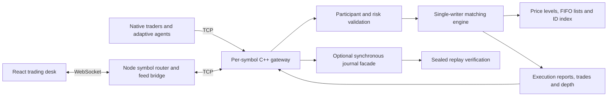

# Apex — Deterministic Exchange Engine

**A C++20 exchange simulator for studying correctness, failure handling and performance in trading infrastructure.**

Apex takes an order from a TCP client through participant risk checks, price-time
matching, execution reports and replayable audit records. Independent symbol books
run in separate processes; a live trading dashboard makes their behavior observable.

The focus is the engineering behind an exchange: **who owns state, which orders
execute first, what happens when a client disappears, and whether an optimization
preserves the result.**

| Engineering result | Evidence |
| --- | --- |
| **1.95–2.19× paired core throughput improvement** | Three saved workloads, five paired blocks each, equivalent event/state signatures |
| **32,000 independently modeled input commands** | Separate vector/sort reference implementation; state and quantity checks after every input |
| **7.5 million raw latency samples audited** | 75 experiment bundles across five policies and three workloads |
| **189 CTest cases + 24 UI/bridge cases** | Local verification includes ASAN/UBSAN, TSAN, Release and a fresh-source rebuild |

**Measurement scope:** the speedup is a historical, same-binary comparison of
synchronous engine calls on Apple M5 arm64—not network latency or production
capacity. [Results and limitations](#performance-backed-by-reproducible-experiments).

## The problem this project addresses

Trading infrastructure must do more than match a buy with a sell. It must preserve
price and time priority, reject invalid requests without partially changing the
book, handle incomplete network messages, bound resource use under overload, and
explain how the system reached its current state.

Apex implements these concerns as one working local system:

| Failure or constraint | How Apex handles it |
| --- | --- |
| Several orders compete at one price | FIFO queues ordered by exchange-assigned priority |
| A market order crosses multiple price levels | Resting-price executions, partial fills and explicit remainder handling |
| A replacement fails validation | Validate first; preserve the original order on rejection |
| A client sends partial or coalesced messages | Length-prefixed binary frames with incremental decoding and partial-write handling |
| Producers or readers fall behind | Bounded queues/output, overload metrics and slow-consumer disconnection |
| A trader disconnects while orders remain live | Owner-only open-order snapshots restore current remaining quantities on reconnect |
| One symbol process stops | That book becomes unavailable; healthy partitions continue without a silent restart |
| An execution needs to be investigated | Sealed command/result journals and deterministic event/state replay |

These are real trading-systems engineering problems. Apex is a **local simulator
that models them**, with explicit contracts and tested boundaries; it does not
connect to a broker or claim to operate a production exchange.

## What is implemented

### Matching and risk

- Limit and market orders, cancellation, replacement and partial execution.
- Price-time priority, resting-price fills, replacement priority reset and
  incoming-order self-trade prevention.
- Integer price ticks and quantities, structural validation and overflow checks.
- Participant quantity, notional, open-order and price-band limits, plus kill switches.
- Ordered price levels, FIFO lists and an ID-to-node index for cancellation
  without scanning the book.

### Transport and recovery

- Nonblocking loopback TCP gateway and native interactive trading clients.
- Explicit big-endian codecs, session-bound participant identity and consecutive
  request sequences; no raw-struct serialization.
- Bounded ingress/output, handshake/idle/incomplete-frame deadlines and observable
  backpressure counters.
- Private open-order synchronization before browser submissions are enabled.
- Versioned, checksummed, synchronously persisted journals with strict sealed replay.

### Live simulation and visualization

- Up to eight symbol partitions, each with its own C++ process, book, writer,
  risk state, sequences and optional journal.
- Adaptive participants that quote from current depth and fill-derived inventory;
  seeded randomness influences their decisions, while the engine determines fills.
- A separate Node WebSocket bridge with one shared observer upstream per symbol.
- React/TypeScript trading desk, symbol selection, depth, recent trades, feed health,
  sequence-gap recovery and persistent dark/cream themes.

The engine and native clients run without Node.js or Python. Those runtimes support
the optional interface, experiments and verification tooling.

## Architecture: one writer owns each book



Mutable matching state stays inside its owning process and writer. Network
consumers receive encoded events or owning snapshots. Parallelism comes from
independent books; it does not require competing writers inside one book.

| Design choice | Reasoning |
| --- | --- |
| Tree price levels + FIFO lists + ID index | Explicit priority, stable nodes and indexed removal |
| Direct risk traversal | Read the authoritative book without constructing owning snapshots or maintaining a second usage ledger |
| Mutex-protected bounded queue | Clear ownership handoff and overload behavior; further concurrency changes need measured justification |
| Per-symbol processes | Isolated mutation, queues, sequence spaces and failure boundaries |
| UI outside C++ matching | Visualization and browser fanout remain outside the matching path |
| Explicit recovery contracts | Public depth, private open state, journal replay and durable retry deduplication solve different problems |

[Architecture](docs/architecture.md) · [Matching rules](docs/matching-rules.md) ·
[Risk controls](docs/risk-controls.md) · [Backpressure](docs/backpressure.md)

## Performance backed by reproducible experiments

Profiling identified owning-book snapshot construction in risk validation. A
read-only traversal removed that work without introducing a second risk ledger.
The candidate and control were then compared on identical saved inputs.

**Historical comparison:** Apple M5 arm64, AppleClang 21, unsanitized Release;
three 100,000-command inputs, five policies and five interleaved paired blocks.
Each bundle uses untimed warmup and separate throughput/latency passes.

| Workload | Median paired throughput ratio: direct risk / snapshot baseline | Baseline → direct-risk p99 |
| --- | ---: | ---: |
| Balanced | **2.188×** | 584 → 250 ns |
| Many levels | **2.139×** | 583 → 250 ns |
| Large partial fills | **1.946×** | 833 → 708 ns |

The experiment contains **75 bundles and 7.5 million audited raw samples**.
Canonical event hashes, final-state hashes and outcome counts match across policies.
Reported ratios are medians of paired candidate/control ratios—not ratios of two
throughput medians.

The evaluation also records decisions that were **not** promoted: flat price levels
remain an explicit research policy because shallow captures do not establish their
behavior on deep books; small initial event buffers were rejected as a default
because large-fill tail latency regressed.

**Limits:** these are synchronous core-call measurements on synthetic inputs.
They exclude TCP, queueing, journaling and UI. macOS scheduling is uncontrolled,
clock readings are quantized, and five paired blocks do not establish statistical
significance or a cross-machine guarantee. Results belong to the retained measured
source, not a claim about the latest application's end-to-end capacity.

[All experiments and trade-offs](docs/optimization-experiments.md) ·
[Portable CSV](results/summary/optimization.csv) ·
[Run records and hashes](results/summary/optimization.json) ·
[Measured-source provenance](results/summary/PROVENANCE.md)

## Correctness checked beyond the production implementation

Policy comparisons alone can miss a bug shared by every configuration. Apex also
uses a test-only reference matcher with an unsorted vector and repeated sorting.
It does not call the production book, matching, risk or codec helpers.

Across **32 seeds × 1,000 inputs**, checks after every command compare:

- Rejections, complete trade tuples and cancellation outcomes.
- Ordered live orders, remaining quantities, ownership, status and priority.
- Per-level quantities, participant usage and sequence continuity.
- Quantity conservation across admissions, trades, cancellations and replacements.

The production default and all eight engine policy combinations are exercised.
A separate hand-calculated scenario checks the reference model itself. Dedicated
risk, overflow, journal and network tests cover behavior outside the oracle's
bounded domain; this is not a claim of exhaustive verification.

The local release passed **189 CTest cases in each of Debug, ASAN/UBSAN, TSAN and
Release**, plus **24 Node UI/bridge cases**. The verification runner also checks
packaging, portable evidence integrity and builds/tests an extracted source archive.

[Independent validation and its limits](docs/independent-validation.md) ·
[Protocol](docs/protocol.md) · [Journal guarantees](docs/journal-and-replay.md)

## Run it locally

### 1. Build and test the C++ system

Requirements: C++20 compiler, CMake 3.20+, Ninja and Git. The first configure fetches
pinned GoogleTest 1.17.0 if it is not installed. Development and local verification
use native macOS arm64; no venv or Linux environment is required.

```sh
cmake --preset debug
cmake --build --preset debug --parallel 4
ctest --preset debug
./build/debug/apex --trading-demo
```

### 2. Start the interactive exchange

For the optional dashboard, install Node.js 24+ and use:

```sh
npm ci --prefix ui
npm --prefix ui run build
npm --prefix ui start -- --symbols APEX,ALPHA,BETA
```

Open **http://127.0.0.1:8080**. Select a symbol and connect participant **1–8** in
Trading desk to submit limit/market orders, cancel, replace or recover open orders.

### 3. Add adaptive participants

In another terminal:

```sh
npm --prefix ui run demo -- --symbol ALPHA
```

Agents **9–12** react to current depth and inventory. Their decisions are synthetic;
execution results come from the C++ engine. ALPHA and BETA are instrument books in
one simulated exchange, not separate venues or external exchange subscriptions.

Stop the agents with **Ctrl+C** first, then stop the exchange terminal. The exact
scripted example remains available as `npm --prefix ui run walkthrough`.

[Dashboard guide](docs/dashboard.md) · [Multi-symbol operation](docs/multi-symbol.md) ·
[Private open-order recovery](docs/private-orders.md)

## Reproduce the verification and measurements

```sh
# Real gateway, clients, live feed, graceful stop and journal replay
python3 scripts/network_demo.py

# Full test/sanitizer matrix, source reconstruction and benchmark auditing
python3 scripts/verify_release.py --clean-source

# New paired implementation-policy experiment
bash scripts/run_experiments.sh
```

The verification output retains tool/build metadata, command logs, source hashes,
raw benchmark data and checksums. Compact historical results and the measured
source travel with this repository; the large historical raw capture is retained
separately. [Benchmark methodology](docs/benchmark-methodology.md) ·
[Release reproduction](docs/release.md) · [Packaging](docs/packaging.md)

## A focused review path

| Start here | What it demonstrates |
| --- | --- |
| [Five-minute reviewer guide](docs/reviewer-guide.md) | A short path through code, correctness, measurements and lifecycle guarantees |
| [`matching_engine.cpp`](src/matching/matching_engine.cpp) | Validation order, matching policy and explicit events |
| [`order_book.hpp`](include/apex/book/order_book.hpp) | Storage, ownership, indexed locations and read-only traversal |
| [Independent reference model](tests/reference/linear_matcher.hpp) | A structurally different correctness check |
| [Differential tests](tests/unit/differential_test.cpp) | Reproducible streams and per-transition assertions |
| [Optimization evidence](results/summary/PROVENANCE.md) | Traceable claims, including limitations and rejected alternatives |

## Current scope

**Version 0.5.0.** This is a local research/educational exchange simulator. It has
no external market feed, broker connection, authenticated public service or
validated profitable strategy. Risk is per symbol, not a portfolio margin ledger.
Private snapshots restore open orders; they do not reconstruct terminal outcomes,
provide idempotent retries or restore a crashed live book.

Native TCP framing and journals are v1; browser routing is v2. Local macOS tests
passed; hosted CI is configured but has not been executed remotely. The dashboard
requires ordinary-browser visual review because automated capture is unavailable
on the development Mac. No public deployment is claimed.

[Changelog](CHANGELOG.md) · [Detailed status](docs/status.md) ·
[Portfolio walkthrough](docs/portfolio.md) · [Resume project sections](docs/resume-project.md)
